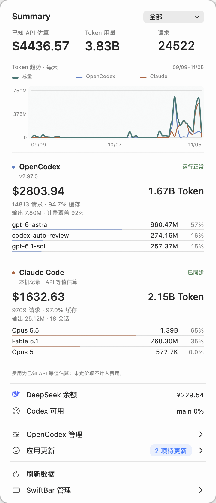

# SwiftBar Token Monitor

SwiftBar 菜单栏插件，使用原生 macOS 面板查看多个 AI 客户端的用量、余额、额度与 Komari 监控。当前版本 **5.5.4**。

<p align="center">
  
</p>

实际运行截图，Summary 选择「全部」，使用实色外观；也支持系统玻璃外观。费用为 API 等值估算，不代表订阅账单。

## 主页与模块

左键星星打开主页。Summary 保留在最上方，下方依次为 **Harness Token 用量、订阅用量、API 余额、其他**；未启用的类别不占位。模块管理也使用相同分类。右键星星提供“主页模块…”、“自动检测”和 SwiftBar 自身管理入口，不重复主页的操作。

“主页模块…”会打开 280pt 宽的紧凑面板：修改自动保存，支持快速连续点击，点击“完成”或面板外部才关闭。也可以直接在主页内右键进入模块管理。悬停模块名称配置数据来源；“外观与设置”紧接顶部的“允许折叠”，之后才是模块分类列表。

“允许折叠”默认开启：Summary 保持完整，各客户端收为两行，保留名称、状态、费用和 Token；点击标题独立展开或收起模型明细，可同时展开多个客户端。各自状态自动保存，刷新、重新打开面板或隐藏再启用模块后保持。关闭开关即可显示全部明细，再开启时恢复原有展开状态；折叠不改变统计结果。内容能完整显示时不滚动、不回弹；只有超出可见高度时才允许双指滚动。

| 模块 | 数据来源与边界 |
| --- | --- |
| Summary | 汇总当前显示的用量来源；共用趋势图显示总量及各来源 |
| OpenCodex | 本机或自定义管理接口的 Token、请求、费用、模型分布；附代理管理 |
| Claude Code | 本机 JSONL 中的用量字段；兼容第三方模型，未知价格显示未计价 |
| ChatGPT 本机用量 | Codex 会话与归档会话的用量事件；不会把缓存或 reasoning 再加一次 |
| OpenCode | 只读 `opencode.db` 中的 assistant 用量与已记录费用 |
| DeepSeek Harness | 用户指定的会话目录；支持 v2–v4 JSONL 和 Zstandard 压缩日志 |
| WorkBuddy | 当前与旧版 `projects` JSONL；按响应 ID 去重，缓存与 reasoning 不重复计数，Credit 不视作美元 |
| Gemini CLI | 本机 JSON / JSONL 会话用量；兼容迁移与重放记录，包含思考 Token |
| DeepSeek API 余额 | 官方 `/user/balance`；可独立配置 API key 文件，也可复用 OpenCodex 已配置的官方 DeepSeek 凭据 |
| ChatGPT 订阅 | 本机 ChatGPT 登录的编程工具额度，或 OpenCodex 管理的 ChatGPT 账户额度；支持选择来源，不代表网页聊天全部限额 |
| Claude / Gemini / Grok / Kimi 订阅 | 独立模块、手动配置标记与官网入口；尚未接入自动额度查询，不读取浏览器登录 |
| Grok API 余额 | xAI 官方 Management API 的团队预付余额，需管理密钥和 Team ID；不是 SuperGrok 订阅额度 |
| MiniMax 订阅 | 官方 Token Plan / M Plan 查询接口；显示滚动和本周剩余百分比 |
| ChatGPT / Claude / MiniMax / Gemini / Kimi API | 识别已有 API 密钥配置或引用用户选择的密钥文件；本版仅提供官网账单入口，未接入余额自动查询 |
| Komari 监控 | 已配置的 Komari 面板、在线状态与服务器详情 |
| 应用更新 | 跟随已勾选的 Harness；已配置 OpenCodex 时也检查 ChatGPT。OpenCodex 自动更新，其他应用仅提醒或提供官网入口 |

订阅顺序为 **ChatGPT、Claude、MiniMax、Gemini、Grok、Kimi**；API 顺序为 **ChatGPT、Claude、DeepSeek、MiniMax、Gemini、Grok、Kimi**。两组单独勾选、单独配置，安装客户端或存在 API Key 不代表已订阅。模块选择与连接设置合并在同一列表，分类与主页一致。

“已配置”旁为绿色实心圆点，“未配置”旁为灰色空心圆点，文字始终保留。圆点只说明存在配置引用或用户保存的手动标记，不代表已验证凭据或付费状态。尚未接入查询的模块显示“官网查看”，不显示伪造的零余额；未设置则显示“未配置”。订阅手动标记保存在本机偏好文件，不复制登录信息。API 官网入口模块不会发送密钥请求。MiniMax API 使用独立的 `MINIMAX_PLATFORM_API_KEY_FILE`，不复用订阅的 `MINIMAX_API_KEY_FILE`。

升级会把原来的 OpenCodex 账户额度迁入 ChatGPT 订阅，并继续使用原有代理来源，不改变已选择的主页模块。界面统一使用 ChatGPT 名称；`codex` 命令、`~/.codex` 路径、内部数据 ID 与模型原名保持兼容。OpenCodex 是独立产品名称。

首次安装自动检测常见客户端命令、WorkBuddy 应用、记录目录和已配置 API 凭据，勾选找到的模块。升级保留已有选择，不会重新打开手动关闭的模块；悬停右键“自动检测”可在旁边查看说明，也可从“外观与设置 → 自动检测”进入。点击“开始检测…”后先扫描，再列出将启用和取消的模块，并提醒会覆盖当前模块选择；默认按钮是“取消”，只有点击“覆盖当前选项”才按检测结果替换勾选。取消保持原设置。未安装、未配置、日志格式不支持或无权限时会显示状态，不会当成零用量。

统计默认当天，可下拉选择近 24 小时、近 7 天、近 30 天、本周、本月或全部。其他子菜单悬停在旁边展开，判定延迟为 80 毫秒。打开 Grok、MiniMax、ChatGPT 额度、Komari 或应用更新侧栏时立即检查对应来源，结果就地更新；5 秒内重复打开会去重。启用账户模块后也会立即检查，不必等待 30 秒轮询。

## 外观

macOS 26+ 使用原生 `NSGlassEffectView` 的 regular 玻璃材质；旧系统使用 `NSVisualEffectView`。界面跟随深浅色和系统“降低透明度”，也可在模块面板中改用实色背景。概览不可选中，不显示悬停提示；左右键菜单互斥。

## 安装与更新

需要 macOS 13+、SwiftBar、Python 3.9+ 和 Xcode Command Line Tools。OpenCodex、Claude Code 等是可选数据源，不是所有模块的共同依赖。macOS 26 上需使用含标题点击修复的 SwiftBar（已验证 2.1.2 build 623）。

```sh
git clone https://github.com/timecatbit/swiftbar-token-monitor.git
cd swiftbar-token-monitor
python3 scripts/check.py
python3 scripts/install.py
```

安装脚本自动读取 SwiftBar 当前的插件目录，也可以显式指定：

```sh
python3 scripts/install.py --plugin-dir '/你的/SwiftBar插件目录'
```

脚本会编译、签名、备份并复制运行所需文件，首次安装自动选择模块，然后刷新 SwiftBar。**安装后可移动或删除源码仓库，插件不依赖仓库路径。** 没有写死用户名或个人 Documents 目录。

SwiftBar 只执行一个入口，但完整的原生界面需要配套运行文件：

```text
SwiftBar 插件目录/
  opencodex.30s.sh
  assets/deepseek-logo.svg
  .opencodex-panel/
    OpenCodexPanel.app/
    lib/
```

仓库中的 `panel/`、`tests/`、`scripts/` 和文档用于开发维护，不需要全部放入 SwiftBar 插件目录。安装器会保留其他插件以及本机设置。

## 本机配置

**右键星星 → 主页模块** 同时管理显示与连接，按 **Harness Token 用量、订阅用量、API 余额、其他** 分组。左侧勾选决定是否显示，右侧圆点与文字表示配置状态；悬停名称或点击箭头直接展开该模块的连接设置，取消勾选后仍可配置。点击复选框或名称可连续多选，鼠标停在复选框上不会弹出侧栏。

每项连接明确显示“已配置”或“未配置”；配置状态不等于连接验证结果。通用外观、自动检测、高级配置文件和恢复默认集中放在“允许折叠”下方的“外观与设置”：

- 本机客户端自动读取标准记录目录；已配置项在下一级显示实际读取目录，可在 Finder 中打开、手动选择或恢复自动查找。API 只显示配置/密钥文件路径，不显示密钥内容。
- ChatGPT 订阅支持自动、本机登录和 OpenCodex 账户三种来源选择；支持选择含 `auth.json` 的配置目录、恢复自动读取及在 Finder 中打开；默认使用 `CODEX_HOME` 或 `~/.codex`。只改变插件读取位置，不修改客户端登录文件，也不影响 ChatGPT 本机用量目录。
- OpenCodex 位于 Harness 分组：可选择配置目录、修改管理地址、选择管理令牌文件及恢复自动读取。选择配置目录时改为读取该目录内的端口和令牌，不保留上一个目录的连接覆盖。
- DeepSeek 优先使用明确指定的密钥文件，否则读取 OpenCodex 的官方 DeepSeek 连接。
- Komari 必须明确提供实际面板地址；空值、注释和示例地址不算配置，不会自动启用。
- Grok 选择管理密钥文件并填写 Team ID；MiniMax 选择套餐密钥文件和地区。全部确认后才保存，任一步取消都不改变设置。
- 配置成功会启用对应模块；清除连接会关闭它，原始密钥文件不会删除。模块也可独立隐藏。

文件各有用途：

| 文件 | 何时写入 |
| --- | --- |
| `~/Library/Application Support/SwiftBarToken/preferences.json` | 模块选择、目录覆盖、材质、各模块展开状态改变时 |
| 同目录 `config.local.sh` | 明确设置地址或密钥文件引用时；也可通过“高级配置文件”编辑 |
| 系统临时目录中的插件缓存 | 数据同步时；连接变更会清除对应旧数据，清缓存不丢偏好 |
| 客户端日志和密钥原文件 | 仅只读访问；插件不修改、不复制密钥 |

项目代码直接位于仓库根目录：`opencodex.30s.sh`、`lib/`、`panel/`、`scripts/`、`tests/`。入口文件名保留，升级后 SwiftBar 不会出现第二个插件。

`config.local.sh` 是唯一的插件用户配置。注释只作说明，不是已启用的设置。安装器不会再自动复制仓库中的私有配置；旧运行目录配置仅在用户配置不存在时迁移一次，已存在的用户配置（即使只有注释）始终优先，旧文件备份后移出。首次安装需要显式导入时可传 `--config /path/to/config.local.sh`；已有用户配置时拒绝覆盖。

Claude Code、ChatGPT 编程客户端、OpenCode、Gemini CLI 按各客户端的标准目录自动检测。WorkBuddy 同时检测 `~/.workbuddy-ai/projects` 和旧版 `~/.workbuddy/projects`，按响应 ID 去重。自定义目录可在“主页模块”中悬停对应客户端后选择，或用 `config.example.sh` 中的环境变量指定。DeepSeek Harness 的存储目录由部署决定，请选择实际的会话日志根目录。读取其压缩日志需要 `zstd`，或支持 Zstandard 的 Node.js；不支持的旧格式会明确标记。

Grok 需设置 `XAI_MANAGEMENT_API_KEY_FILE` 和 `XAI_TEAM_ID`，使用具备账单读取权限的管理密钥；普通推理 API key 不适用。MiniMax 需设置 `MINIMAX_API_KEY_FILE`（套餐密钥），可选 `MINIMAX_REGION=china`，默认国际区。只发送读取请求，不调用模型或充值；未配置的模块会给出提示。

自动检测只查看客户端安装状态、标准目录中的记录文件是否存在，以及当前环境变量、插件本机配置、OpenCodex 官方 DeepSeek 配置与 ChatGPT 编程客户端登录状态；也保留已手动配置的订阅入口。不扫描对话内容、浏览器或钥匙串，不复制凭据、不发送验证请求；检测到配置不代表凭据一定有效；已接入自动查询的模块在打开时检查，官网入口模块不发请求。刚安装但尚无记录的客户端会显示暂无数据；DeepSeek Harness 可能还需要指定记录目录。

## 后台开销

SwiftBar 的 30 秒入口保留，但复用缓存：面板关闭时短周期数据改为约 3 分钟检查，电池供电时约 5 分钟；余额等低频来源保持自身较长间隔。打开面板立即按正常刷新时效检查，资源侧栏和手动刷新仍可主动更新。电源状态最多每 5 分钟读取一次。

原生面板通过目录变化事件接收快照和动作回执，关闭时不运行每秒计时器，也不监听全局鼠标移动。相同快照不重复写入；一次后台同步只触发一次 SwiftBar 刷新。未配置的 Komari、Grok、MiniMax 和未登录的 ChatGPT 不发起查询。

## 统计口径与隐私

- 费用是已知价格的 API 等值估算，或客户端记录的费用，不是订阅账单。没有价格的数据会保留 Token 并标记未计价。
- 同时显示 OpenCodex 和 ChatGPT 本机用量时，OpenCodex 有可用数据则作为 Summary 的统计来源；ChatGPT 保留独立明细，避免同一调用跨代理和客户端重复相加。关闭 OpenCodex 后，ChatGPT 会计入 Summary。
- 其他客户端会排除明确标记为 `opencodex`/`ocx` 的代理记录。自定义路由名及跨工具导入的历史可能仍重叠，使用共享代理时应选择合适的统计来源。
- 按系统时区统计，可通过 `OCX_TIMEZONE` 覆盖。周从周一开始；近 24 小时为滚动窗口，近 7/30 天含当天。
- 本机日志只索引用量元数据，不保存对话正文；数据库只读，增量索引和设置仅当前用户可读。余额和订阅额度不加入费用汇总。
- ChatGPT 额度通过客户端已有的 ChatGPT 登录查询，不自动登录、不调用模型；API-key-only 登录不能提供该订阅额度。此模块不声称覆盖 ChatGPT 网页所有聊天限额。
- 应用更新跟随 Harness 分组的勾选：OpenCodex 对应自动更新，Claude Code 用量模块对应 **Claude 桌面 App** 的更新检查，ChatGPT 本机用量对应 ChatGPT 桌面客户端。Claude 不再检查命令行版本；未安装桌面 App 时明确显示未安装。另有一项联动：已配置 OpenCodex 时，无论其主页模块是否勾选，都会把 ChatGPT 纳入更新检查；不改变主页勾选。没有 OpenCodex 配置时只按 Harness 勾选，订阅/API 勾选不触发应用更新。移出检查范围的应用立即移除其更新条目和数量。
- DeepSeek 余额刷新期间保留主页金额，不追加“上次”；刷新进度、成功更新时间与失败状态放在余额侧栏。失败时明确说明正在保留最近余额。
- OpenCode、DeepSeek Harness、WorkBuddy、Gemini CLI 已选中时显示官网更新入口，明确标记尚未接入自动版本检查；不会声称已是最新。关闭“应用更新”停止提醒和非 OpenCodex 检查；OpenCodex 仅在其 Harness 被选中时自动检查与更新。已启动的安装仅继续确认结果，不重复启动。

接口与格式依据：[Apple 原生玻璃](https://developer.apple.com/documentation/appkit/nsglasseffectview)、[Codex App Server](https://learn.chatgpt.com/docs/app-server)、[DeepSeek 余额](https://api-docs.deepseek.com/api/get-user-balance/)、[DeepSeek Harness 存储](https://github.com/deepseek-ai/deepseek-harness/tree/master/packages/session/session-persistence-jsonl)、[OpenCode 数据目录](https://opencode.ai/docs/troubleshooting/)、[Gemini 会话格式](https://github.com/google-gemini/gemini-cli/blob/main/packages/core/src/services/chatRecordingTypes.ts)、[xAI 账单接口](https://docs.x.ai/developers/rest-api-reference/management/billing)、[MiniMax 官方额度解析](https://github.com/MiniMax-AI/cli/blob/main/src/utils/quota.ts)。

## 开发维护

`opencodex.30s.sh` 负责采集协调、缓存与 SwiftBar 入口；`lib/` 负责独立采集器与偏好设置；`panel/Panel.swift` 负责原生界面。

```sh
python3 scripts/check.py   # 隔离测试，不运行实际插件
python3 scripts/build.py   # 仅构建到忽略的 build/
python3 scripts/install.py # 安装、保留备份、刷新
```

备份位于 `~/Library/Application Support/SwiftBarToken/backups/`。界面修改安装后需实际点星星验证深浅色、下拉范围、多选持久化、悬停侧栏及左右键互斥；不能只凭编译通过判断视觉效果。
